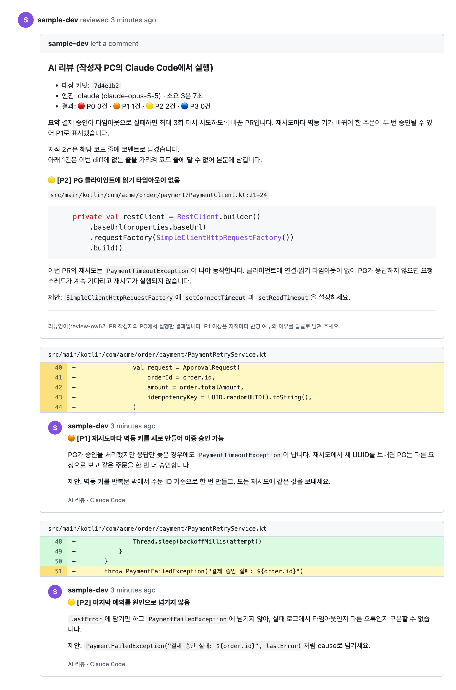
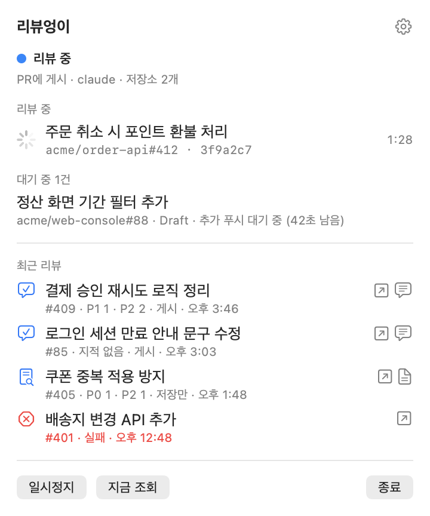
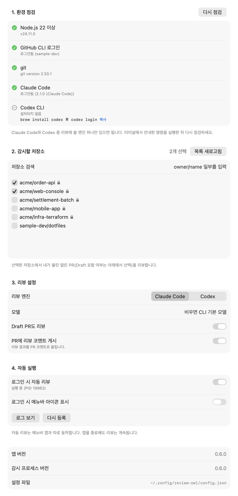

<p align="center"></p>

# 리뷰엉이 (review-owl)

내가 올린 PR(일반·Draft)을 감지해, 이 PC에 로그인된 Claude Code 또는 Codex CLI로 리뷰하는 로컬 상주 도구입니다. CI에 외부 API 키를 두지 않고, 각자 쓰는 AI 좌석으로 리뷰를 돌립니다.

macOS에서는 메뉴바 앱으로 설치·설정·상태 확인을 하고, 터미널에서는 같은 기능을 CLI로 씁니다. 메뉴바 아이콘은 마스코트 리뷰엉이로 감시 상태를 보여 줍니다.

v0.5.0까지의 이름은 pr-ai-reviewer입니다. 쓰던 분은 [5.4](#54-v050-이하pr-ai-reviewer에서-옮기기)를 따라 옮겨 주세요.



📌 README의 화면 이미지는 샘플 데이터로 만들었습니다. 저장소·계정 이름은 실제가 아닙니다.

## 1. 빠른 시작

macOS 메뉴바 앱 기준으로 설치부터 첫 리뷰까지 4단계입니다. CLI만 쓰려면 [1.2](#12-cli로-시작)를 봅니다.

### 1.1 메뉴바 앱으로 시작

1. 리뷰에 쓸 CLI에 로그인합니다. GitHub CLI와 리뷰 엔진(Claude Code 또는 Codex) 하나가 필요합니다.

   ```bash
   gh auth login
   claude auth login     # Codex를 쓰면 codex login
   ```

2. 앱을 설치하고 엽니다. node와 gh는 함께 설치됩니다.

   ```bash
   brew install --cask juhee200/tap/review-owl
   open "/Applications/Review Owl.app"
   ```

3. 처음 열면 나오는 설정 창을 위에서부터 채운 뒤 저장합니다.

   | 순서 | 할 일 |
   |---|---|
   | 1. 환경 점검 | 모든 필수 항목이 초록색인지 확인. 빠진 도구는 설치 명령과 복사 버튼이 나옴 |
   | 2. 감시할 저장소 | 내 PR을 리뷰할 저장소에 체크 |
   | 3. 리뷰 설정 | 엔진 선택. PR에 바로 올리려면 "PR에 리뷰 코멘트 게시"를 켬. 끄면 이 PC에만 저장(dry-run) |
   | 4. 자동 실행 | "로그인 시 자동 리뷰"를 켬 |

4. 감시 중인 저장소의 내 PR에 커밋을 푸시합니다. 마지막 푸시 후 최대 2분 30초(조회 간격 60초 + 추가 푸시 대기 90초) 안에 리뷰를 시작합니다. 진행 상황과 결과는 메뉴바 아이콘에서 확인합니다.

### 1.2 CLI로 시작

```bash
npm install -g --install-links git+https://github.com/juhee200/review-owl.git#v0.6.0
review-owl init                                      # 설정 파일 생성
echo '{"repos":["owner/name"]}' | review-owl config set
review-owl doctor                                    # 도구·로그인·설정 점검
review-owl review owner/name 123                     # PR 하나를 리뷰해 결과만 출력 (게시하지 않음)
review-owl service install --post                    # 로그인 시 자동 실행 + PR에 게시
```

설치 옵션과 명령 전체는 [5. 설치](#5-설치)와 [7. 사용법](#7-사용법)에 있습니다.

## 2. 화면

<table>
  <tr>
    <th>메뉴바</th>
    <th>설정 창</th>
  </tr>
  <tr>
    <td valign="top"></td>
    <td valign="top"></td>
  </tr>
</table>

| 화면 | 보이는 내용 |
|---|---|
| 메뉴바 | 감시 상태, 리뷰 중·대기 중인 PR, 최근 리뷰 5건(심각도별 건수, 게시 여부). 행 오른쪽 버튼으로 PR, 게시한 코멘트, 이 PC에 저장한 결과 파일을 엶 |
| 설정 창 | 환경 점검, 감시할 저장소, 리뷰 엔진·모델·Draft 포함·게시 여부, 자동 실행 등록 |
| PR 리뷰 (맨 위 이미지) | 리뷰 본문에 대상 커밋·엔진·심각도별 건수·요약. diff 안의 지적은 해당 코드 줄 코멘트로, diff 밖의 지적은 코드를 인용해 본문에 담음 |

메뉴바 아이콘은 리뷰엉이에 상태를 겹쳐 보여 줍니다.


| 아이콘 | 상태 |
|---|---|
| 리뷰엉이 | 감시 중 |
| 파란 점 | 리뷰 중 |
| 흐리게 | 일시정지 |
| 주황 점 | 확인 필요. 감시 프로세스가 실행 중이 아니거나, 마지막 조회에 오류가 있거나, 앱이 CLI를 찾지 못함. 메뉴바 창에 원인이 나옴 |

## 3. 동작 방식

```
[개발자 PC]
60초마다 gh로 '내가 올린 열린 PR' 조회 (설정한 저장소)
 → 아직 리뷰하지 않은 head 커밋 발견 (로컬 상태 + PR 코멘트·리뷰의 표식으로 판정)
 → 마지막 푸시 후 90초 동안 추가 푸시가 없으면 리뷰 (연속 푸시를 한 번으로 묶음)
 → 캐시 bare 저장소에 PR 커밋을 git worktree로 체크아웃 (작업 중인 폴더는 건드리지 않음)
 → claude -p 또는 codex exec로 리뷰 (읽기 전용, 정해진 JSON 형식으로 출력)
 → dry-run: 출력·파일 저장만 / --post: PR 리뷰로 게시 (지적마다 해당 코드 줄에 코멘트)
```

PR을 IntelliJ, 웹, CLI 중 어디서 만들었는지와 관계없이 GitHub에 생긴 PR을 조회하므로 모두 감지합니다. 조회 간격만큼 늦게 감지할 수 있습니다.

게시 모드에서는 리뷰 1건을 GitHub PR 리뷰(Comment) 하나로 올리고, 지적을 위치에 따라 나눠 담습니다.

| 위치 | 담는 내용 |
|---|---|
| 리뷰 본문 | 대상 커밋, 엔진, 심각도별 건수, 요약 |
| 코드 줄 코멘트 | 이번 diff에 나오는 줄을 가리키는 지적. 1건당 코멘트 1개라 지적마다 답글을 달고 따로 resolve할 수 있음 |
| 리뷰 본문 아래 | diff 밖의 줄이나 줄 번호가 없는 지적. 해당 코드를 head 커밋에서 읽어 코드 블록으로 인용 |

- 심각도는 🔴 P0 · 🟠 P1 · 🟡 P2 · 🔵 P3으로 표시합니다.
- 코드 줄 코멘트는 AI가 지적한 줄 범위(`line`~`endLine`)에 달려, GitHub가 그 코드를 코멘트 위에 보여 줍니다.
- GitHub가 코멘트 위치나 커밋을 받지 않으면(HTTP 422) 모든 지적을 리뷰 본문에 인용과 함께 넣어 다시 게시합니다. 리뷰 중에 강제 푸시로 커밋이 PR에서 빠진 경우가 여기에 해당합니다.
- dry-run 출력과 로컬 결과 파일에는 모든 지적을 코드 인용과 함께 담습니다.

## 4. 요구 사항

메뉴바 앱은 설정 창의 "환경 점검"에서 아래 항목을 확인합니다. Homebrew로 앱을 설치하면 node와 gh는 함께 설치됩니다.

| 항목 | 확인 방법 |
|---|---|
| Node.js 22.18 이상 | `node -v` |
| GitHub CLI 로그인 | `gh auth status` |
| git https 인증 (기존 clone이 되는 상태) | `git ls-remote https://github.com/<owner>/<repo>.git` |
| Claude Code 로그인 (엔진이 claude일 때) | `claude -p "hi"` |
| Codex CLI 로그인 (엔진이 codex일 때) | `codex login status` |

## 5. 설치

### 5.1 메뉴바 앱 (macOS 14 이상)

```bash
brew install --cask juhee200/tap/review-owl
```

1. 앱을 처음 열면 설정 창이 열립니다. 위에서부터 채웁니다.
   - ① 환경 점검: 빠진 도구는 설치 명령을 보여 줍니다.
   - ② 감시할 저장소 선택
   - ③ 리뷰 엔진·모델·Draft 포함·PR 게시 여부
   - ④ 로그인 시 자동 리뷰 켜기
2. 메뉴바 아이콘을 누르면 다음 내용이 보입니다.
   - 감시 상태와 다음 조회까지 남은 시간
   - 리뷰 중·대기 중인 PR
   - 최근 리뷰: PR, 게시한 코멘트, 이 PC에 저장한 결과 파일을 열 수 있습니다.
   - 일시정지·지금 조회 버튼
3. 앱은 화면과 제어만 맡고, 리뷰는 로그인 시 자동 실행되는 감시 프로세스가 합니다. 앱을 종료해도 리뷰는 계속됩니다.

| 작업 | 명령 | 동작 |
|---|---|---|
| 업데이트 | `brew upgrade --cask review-owl` | 앱을 바꿈. 감시 프로세스는 진행 중인 리뷰를 끝낸 뒤 다음 조회 때(기본 60초 간격) 새 버전을 확인하고 새 버전으로 다시 시작 |
| 삭제 | `brew uninstall --cask review-owl` | 감시 프로세스가 앱이 2분 넘게 없는 것을 확인하면 자동 실행 등록을 지우고 종료 (시험에서 약 2분 30초) |
| 설정·기록까지 삭제 | `brew uninstall --zap --cask review-owl` | 자동 실행 등록과 설정·상태·캐시·로그 폴더 삭제 |

- 개발자 인증서 없이 ad-hoc 서명한 앱입니다. cask가 설치할 때 quarantine 속성을 지워 Gatekeeper가 막지 않습니다. Release의 zip을 직접 받아 설치했다면 `xattr -dr com.apple.quarantine "/Applications/Review Owl.app"`을 실행한 뒤 엽니다.
- npm으로 설치한 CLI로 자동 실행을 등록해 두었다면, 설정 창 ④에서 "이 앱으로 다시 등록"을 누릅니다. 그래야 앱을 업데이트할 때 감시 프로세스도 함께 바뀝니다.

### 5.2 CLI

GitHub 저장소에서 바로 설치합니다. 빌드된 `dist`가 저장소에 들어 있어 설치할 때 빌드하지 않습니다.

```bash
npm install -g --install-links git+https://github.com/juhee200/review-owl.git#v0.6.0
review-owl init
```

`--install-links`를 빼면 npm(11.17에서 확인)이 패키지를 복사하지 않고 임시 폴더로 링크만 걸어, 설치 직후 명령을 찾지 못합니다.

새 버전은 태그만 바꿔 같은 명령을 다시 실행하고, 삭제는 `npm uninstall -g review-owl`로 합니다.

### 5.3 소스에서 실행·빌드

소스에서 직접 실행하려면 다음과 같이 합니다. Node의 TypeScript 타입 제거 기능을 써서 빌드 없이 실행됩니다.

```bash
git clone https://github.com/juhee200/review-owl.git
cd review-owl && npm install
node src/cli.ts --help
```

릴리스할 때는 `npm run build`로 `dist`를 다시 만든 뒤 함께 커밋하고 태그를 붙입니다.

메뉴바 앱은 Xcode 16 이상(Swift 6)에서 `scripts/build-app.sh`로 만듭니다. `build/Review Owl.app`과 Release에 올릴 zip이 생깁니다. 앱 소스는 `app/`에 있고, 앱 번들 안에 `dist`를 넣어 시스템 node로 실행합니다.

`REVIEW_OWL_CONFIG` 환경 변수로 설정 파일 경로를 바꿀 수 있습니다. 메뉴바 앱도 이 값을 CLI에 그대로 넘깁니다. v0.5.0까지 쓰던 `PR_AI_REVIEWER_CONFIG`도 읽습니다.

README 이미지(`docs/images/`)는 `scripts/readme-images/capture.sh`로 다시 만듭니다. Xcode, Google Chrome, gh 로그인이 필요합니다.

| 이미지 | 만드는 방법 |
|---|---|
| `menu.png`, `settings.png`, `menubar-icons.png` | 앱의 스냅샷 모드(`REVIEW_OWL_SNAPSHOT_DIR`)에 가짜 CLI(`fake-cli.mjs`)와 샘플 상태(`sample-state.mjs`)를 연결해 그림. 설치된 앱과 겹치지 않게 번들 ID를 바꾼 임시 앱으로 실행 |
| `pr-review.png` | `src/render.ts`로 샘플 리뷰를 만들고 GitHub 마크다운 API로 HTML을 만든 뒤 Chrome headless로 찍음 |

### 5.4 v0.5.0 이하(pr-ai-reviewer)에서 옮기기

v0.6.0에서 이름을 리뷰엉이(review-owl)로 바꿨습니다. 앱, 명령, cask, 폴더 이름이 바뀌어 새로 설치해야 합니다. 설정과 리뷰 기록은 그대로 옮겨집니다.

```bash
brew uninstall --cask pr-ai-reviewer          # npm으로 설치했다면 npm uninstall -g pr-ai-reviewer
brew install --cask juhee200/tap/review-owl   # npm이면 5.2의 설치 명령
open "/Applications/Review Owl.app"
```

1. 새 앱이나 CLI를 처음 실행하면 옛 자동 실행을 내리고, 옛 폴더를 새 이름으로 옮깁니다. 새 폴더가 이미 있으면 옮기지 않습니다.

   | 옛 폴더 | 새 폴더 |
   |---|---|
   | `~/.config/pr-ai-reviewer` | `~/.config/review-owl` |
   | `~/.local/state/pr-ai-reviewer` | `~/.local/state/review-owl` |
   | `~/.cache/pr-ai-reviewer` | `~/.cache/review-owl` |
   | `~/Library/Logs/pr-ai-reviewer` | `~/Library/Logs/review-owl` |

2. 설정 창 4번에서 "로그인 시 자동 리뷰"를 다시 켭니다. CLI만 쓰면 `review-owl service install --post`를 실행합니다.
3. PR 코멘트의 숨은 표식은 바꾸지 않았습니다. 그래서 이미 리뷰한 커밋은 다시 리뷰하지 않습니다.

## 6. 설정

`review-owl init`이 `~/.config/review-owl/config.json`을 만듭니다. `repos`를 감시할 저장소로 바꿔 주세요. 파일을 직접 고치는 대신 `config set`으로 검증을 거쳐 바꿀 수도 있습니다.

```bash
review-owl repos                                    # 선택할 수 있는 저장소 목록 ([x]는 설정에 있는 저장소)
echo '{"repos":["owner/name"]}' | review-owl config set
review-owl config show
```

감시 중에 설정 파일을 바꾸면 다음 조회부터 적용합니다. 진행 중인 리뷰는 시작할 때의 설정으로 끝냅니다. `stateDir`은 재시작해야 적용됩니다.

| 키 | 기본값 | 설명 |
|---|---|---|
| `repos` | (필수) | 감시할 저장소 목록. `owner/name` 형식 |
| `pollIntervalSec` | 60 | PR 조회 간격(초) |
| `debounceSec` | 90 | 새 커밋을 본 뒤 추가 푸시를 기다리는 시간(초). 0이면 바로 리뷰 |
| `includeDrafts` | true | Draft PR도 리뷰 |
| `engine` | `claude` | `claude` 또는 `codex` |
| `model` | null | 엔진 모델. null이면 각 CLI의 기본 모델 |
| `maxBudgetUsd` | null | Claude `--max-budget-usd` 상한 |
| `timeoutSec` | 900 | 리뷰 1건 제한 시간(초) |
| `maxDiffLines` | 3000 | 프롬프트에 직접 넣을 diff 최대 줄 수. 넘으면 앞부분만 넣고 나머지는 AI가 git으로 읽음 |
| `dryRun` | true | true면 PR에 게시하지 않음. `run`·`review`의 `--post`로 덮어씀 |
| `maxFailures` | 3 | 같은 커밋에서 이 횟수만큼 실패하면 새 커밋까지 건너뜀 |
| `claudeSettingSources` | `project` | Claude `--setting-sources`. 개인 hook·설정이 리뷰 실행에 끼지 않게 함 |
| `cacheDir` | `~/.cache/review-owl` | 저장소 캐시와 worktree |
| `stateDir` | `~/.local/state/review-owl` | 상태, 실행 기록(`runs.jsonl`), 리뷰 결과 파일(`reviews/`), 감시 상태(`status.json`) |

## 7. 사용법

```bash
review-owl run --plan                 # 리뷰하지 않고 판정 결과만 확인
review-owl run                        # 감시 시작 (기본 dry-run)
review-owl run --post                 # 감시하며 PR에 게시
review-owl review owner/repo 123      # PR 하나를 지금 리뷰 (기본 dry-run)
review-owl review owner/repo 123 --engine codex
review-owl review owner/repo 123 --sha <40자리 커밋>   # 과거 커밋 기준 리뷰 (평가용)
review-owl status                     # 대기·리뷰 기록
review-owl doctor                     # node, gh 로그인, git, claude, codex, 설정, 자동 실행 점검
review-owl ctl pause                  # 실행 중인 감시 일시정지 (resume: 재개, poll-now: 바로 조회)
```

로그는 stderr, 리뷰 본문은 stdout으로 나갑니다. dry-run 결과도 `stateDir/reviews/`에 파일로 남습니다.

`doctor`, `repos`, `config show`, `service status`는 `--json`을 붙이면 JSON으로 출력합니다.

## 8. 로그인 시 자동 실행 (macOS)

```bash
review-owl service install --post   # 게시 모드로 등록 (--dry-run이면 게시하지 않음)
review-owl service status           # 상태와 최근 로그
review-owl service restart          # 등록된 자동 실행을 다시 시작 (도구를 새로 설치한 뒤)
review-owl service uninstall        # 해제
```

- `service install`에 준 `--post`·`--dry-run`·`--engine`·`--model`은 설정 파일에 저장됩니다. 자동 실행은 설정 파일만 보고 동작하므로, 이후 설정을 바꾸면 다시 등록하지 않아도 다음 조회부터 적용됩니다.
- 사용자 계정의 `~/Library/LaunchAgents/io.github.juhee200.review-owl.agent.plist`로 등록되어 관리자 권한이 필요 없습니다. 예전 이름으로 등록된 자동 실행(v0.5.0까지 `io.github.juhee200.pr-ai-reviewer.agent`, v0.2.0까지 `com.github.juhee200.pr-ai-reviewer`)은 등록·해제할 때 함께 정리합니다.
- launchd는 셸의 PATH를 물려받지 않습니다. 그래서 등록할 때 node, gh, git, claude, codex의 경로를 찾아 plist에 넣습니다. 도구를 새로 설치하거나 옮겼다면 다시 등록하세요.
- 로그는 `~/Library/Logs/review-owl/agent.log`에 남습니다.
- 비정상 종료하면 다시 시작하고, 로그아웃이나 해제로 정상 종료하면 다시 시작하지 않습니다.
- 앱이나 CLI를 새 버전으로 바꾸면, 감시 프로세스가 다음 조회 때 설치된 버전이 바뀐 것을 보고 종료 코드 75로 끝납니다. launchd가 이를 비정상 종료로 보고 새 버전으로 다시 시작합니다. Homebrew는 cask 설치 후 명령을 샌드박스에서 실행해 launchd 작업을 직접 다시 시작할 수 없어 이 방식을 씁니다.
- 실행 명령 앞에 `/bin/sh` 검사를 붙여, CLI 파일이 없으면(앱이나 npm 패키지를 지운 경우) 오류 대신 정상 종료합니다. 그래서 launchd가 실패한 실행을 반복하지 않습니다. 실행 중에 CLI 파일이 2분 넘게 없으면 감시 프로세스가 자동 실행 등록을 지우고 끝납니다.
- 처음 켜면 이미 열려 있는 내 PR 중 아직 리뷰하지 않은 커밋도 찾아 리뷰합니다. dry-run으로만 리뷰한 커밋은 게시 모드에서 다시 리뷰해 게시합니다.

## 9. 안전 설계

- 외부 명령은 셸을 거치지 않고 인자 배열로 실행합니다. 저장소 이름, PR 번호, 커밋 SHA, 브랜치 이름은 형식을 검증한 뒤 씁니다.
- AI는 읽기 전용입니다.
  - Claude: 사용 가능 도구를 `Read, Grep, Glob`으로 한정합니다. Bash는 넣지 않습니다. `Bash(git diff:*)`처럼 접두어로 허용하면 `git diff --output=<경로>`로 파일을 쓸 수 있기 때문입니다. 전체 diff는 worktree 밖 임시 파일로 두고 `--add-dir`로 읽게 합니다. MCP 서버는 연결하지 않습니다.
  - Codex: `--sandbox read-only`로 실행합니다.
- PR 제목·diff·커밋 메시지 안의 지시는 데이터로 취급하라고 프롬프트에 명시하고, 데이터 영역의 닫는 태그를 무력화합니다.
- 코드·테스트·빌드를 실행하지 말고 작업 디렉터리와 전체 diff 파일 밖은 읽지 말라고 지시합니다. Codex의 읽기 전용 샌드박스는 쓰기와 네트워크는 막지만 파일 읽기는 막지 않습니다. 그래서 게시 직전에 리뷰 본문을 비밀값 패턴(개인 키, AWS·GitHub·Slack·API 키)으로 검사하고, 걸리면 게시하지 않고 로컬 파일로만 남깁니다.
- PR 게시는 AI가 아니라 프로그램이 합니다. AI 문장 안의 `@아이디` 멘션과 숨은 HTML 주석은 무력화한 뒤 게시합니다.
- 코드 인용도 프로그램이 head 커밋 체크아웃에서 읽습니다. AI가 준 경로가 작업 디렉터리 밖(`..`, 절대 경로, 밖을 가리키는 심볼릭 링크)이거나 `.git`, 바이너리 파일이면 인용하지 않습니다. 인용한 코드도 게시 전 비밀값 검사 대상입니다.
- 토큰은 직접 다루지 않고 gh·git의 기존 인증을 씁니다. 로그에 환경변수를 남기지 않습니다.
- 리뷰는 PR 작성자 PC의 AI 서비스로 코드를 보냅니다. 평소 그 CLI로 회사 코드를 다루는 범위와 같은지 회사 정책을 확인한 뒤 쓰세요.

## 10. 한계

- 조회 방식이라 최대 `pollIntervalSec + debounceSec`만큼 늦게 리뷰합니다.
- 작성자 PC가 꺼져 있으면 리뷰하지 않습니다. 켜지면 열린 PR 중 리뷰하지 않은 커밋을 리뷰합니다.
- 첫 리뷰 때 저장소 캐시를 만들고 head 커밋의 파일을 받으므로 시간이 더 걸립니다.
- GitHub는 PR diff에 나오는 줄에만 코드 줄 코멘트를 받습니다. diff 밖을 가리키는 지적은 리뷰 본문에 남기므로 그 지적에는 별도 답글 스레드가 생기지 않습니다.
- 작성자 계정으로 게시하므로 리뷰 상태는 항상 Comment입니다. GitHub는 자기 PR의 승인·변경 요청을 막습니다.

## 11. 라이선스

[MIT](LICENSE)
